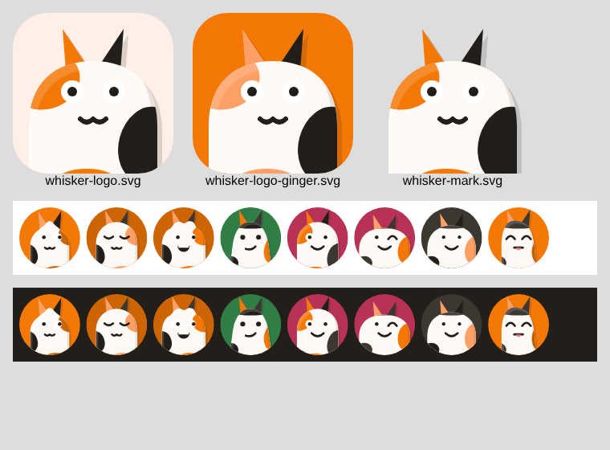
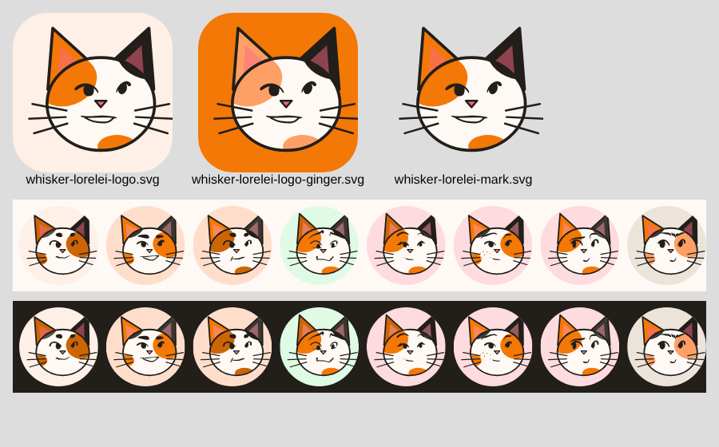

# Logo DiceBear



## Cara kerja

DiceBear 10 menggambar avatar dari **style definition JSON** dan sebuah **seed** secara deterministik
(seed + opsi yang sama → SVG yang identik di semua bahasa). Tidak ada style kucing bawaan, jadi Whisker
punya style sendiri: `design/dicebear/whisker-calico.json`.

| komponen | varian | warna |
| --- | --- | --- |
| `ears` | `pointy`, `round` | `earLeft` (oranye), `earRight` (hitam), dalam telinga `nose` |
| `patches` (dipotong mengikuti bentuk kepala) | `classic`, `mask`, `splash` | `patchA` (oranye), `patchB` (hitam) |
| `eyes` | `open`, `happy`, `wink` | `eye` (hijau/amber), garis `line` |
| `mouth` | `smile` | `nose`, `line` |
| `whiskers` | `long` | `line` |
| kepala | – | `fur`, garis luar `line` |

Semua warna diambil dari skala token calico (lihat [Desain Warna](Desain-Warna.md)).

## Logo resmi

Logo = style `whisker-calico` dengan seed `Whisker` dan **varian + warna terkunci**
(`pointy`, `classic`, `open`, oranye `#F47806`, hitam `#221E1A`, mata `#56B870`). Konfigurasinya di
`design/tools/render-logo.mjs`.

| file | pakai untuk |
| --- | --- |
| `design/logo/whisker-logo.svg` | ikon aplikasi utama (latar krem `ginger.100`, sudut membulat) |
| `design/logo/whisker-logo-ginger.svg` | splash / store listing (latar `ginger.500`) |
| `design/logo/whisker-mark.svg` | tanda tanpa latar (header, favicon, dokumen) |
| `design/logo/avatar-samples.svg` | contoh avatar pengguna |

Render ulang:

```bash
cd design/tools && npm install && npm run logo
```

Ikon per platform (Android adaptive icon, iOS, web, desktop) dihasilkan dari `whisker-logo.svg` saat
aplikasi Flutter dibuat; tool-nya ditentukan bersama daftar extension lintas platform
(lihat [Tech Stack](Tech-Stack.md)).

## Avatar pengguna

Avatar default pengguna dan agent = style yang sama dengan `seed` = id pengguna, tanpa mengunci varian,
sehingga setiap orang mendapat kucing calico yang unik tapi tetap satu keluarga dengan logo. Gunakan
paket DiceBear untuk Dart (bila tersedia untuk versi 10) atau render di server lalu cache sebagai SVG.

## Aturan

- Logo **tidak** digambar ulang manual; ubah style JSON atau opsi di `render-logo.mjs`, lalu render.
- Setelah render, cek `design/logo/preview.png` (dibuat ulang lewat screenshot) di latar terang dan gelap.
- Style memuat atribusi di `meta`; lisensinya mengikuti lisensi repo (lihat [Tech Stack](Tech-Stack.md)).

## Alternatif: kucing gaya Lorelei



[Lorelei](https://www.dicebear.com/styles/lorelei/) karya Lisa Wischofsky berlisensi **CC0 1.0**
(public domain, bebas dipakai komersial dan di-remix tanpa atribusi). Lorelei aslinya wajah manusia,
jadi Whisker me-*remix*-nya menjadi style `design/dicebear/whisker-lorelei-cat.json`:

- **diambil dari Lorelei:** komponen `eyes` (24 varian), `eyebrows`, `mouth` (hanya varian `happy*`),
  `freckles`, beserta gaya garis hitamnya;
- **dibuat Whisker:** kepala kucing, `ears` (`pointy`, `tilted`), `patches` calico (`classic`, `mask`,
  `splash`), hidung kucing, dan kumis.

Style ini **dibangun oleh skrip**, jangan diedit manual:

```bash
cd design/tools && npm install
python3 build-lorelei-cat.py   # tulis ulang design/dicebear/whisker-lorelei-cat.json
npm run lorelei                # render design/logo/lorelei/
```

Kandidat logo: seed `Whisker`, `pointy` + `classic`, mata `variant04`, mulut `happy06`, tanpa alis dan
bintik. **Logo resmi (`whisker-calico` atau kucing Lorelei) belum diputuskan**; sampai diputuskan,
`whisker-calico` tetap dipakai di README.
